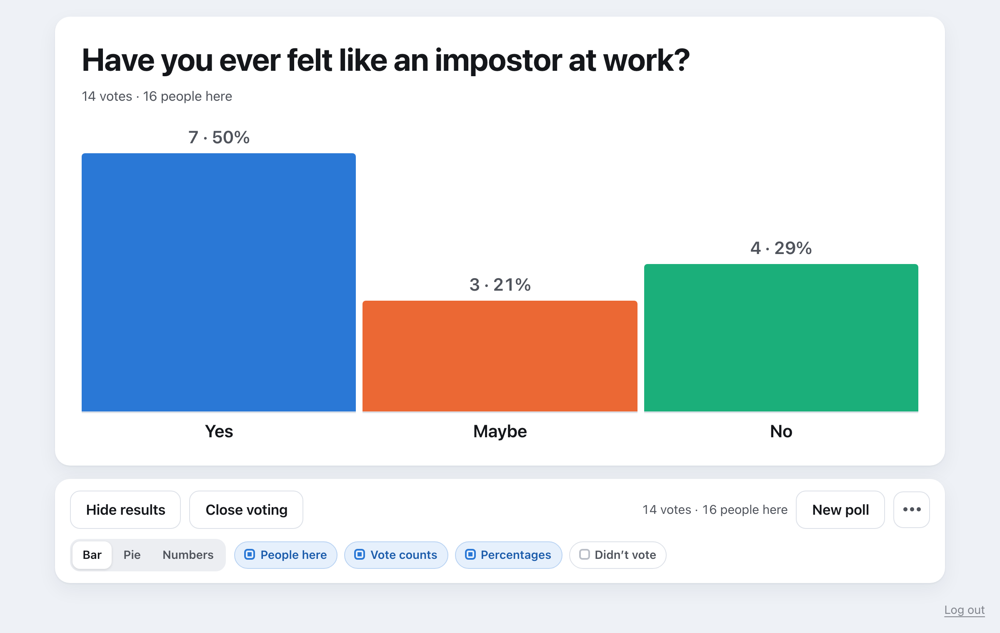
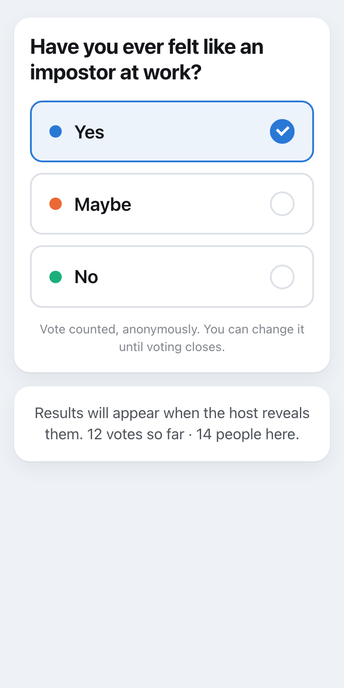
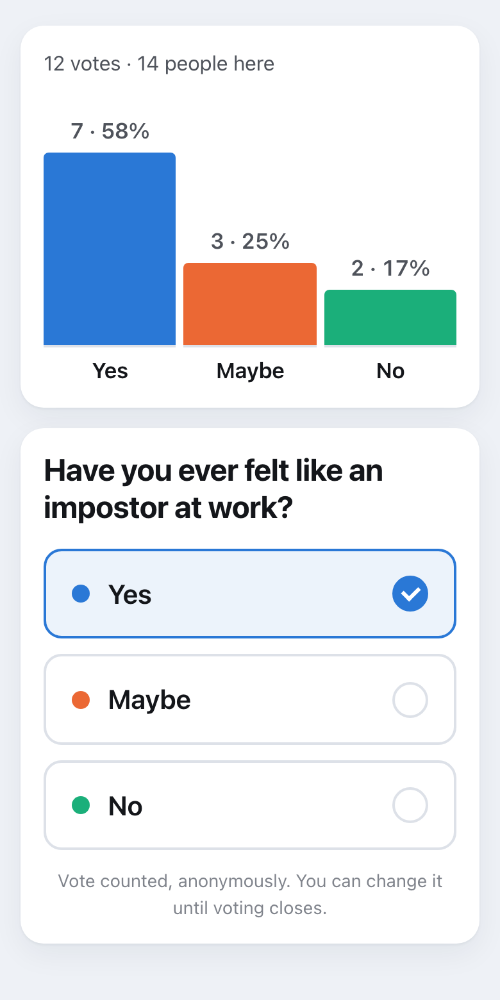
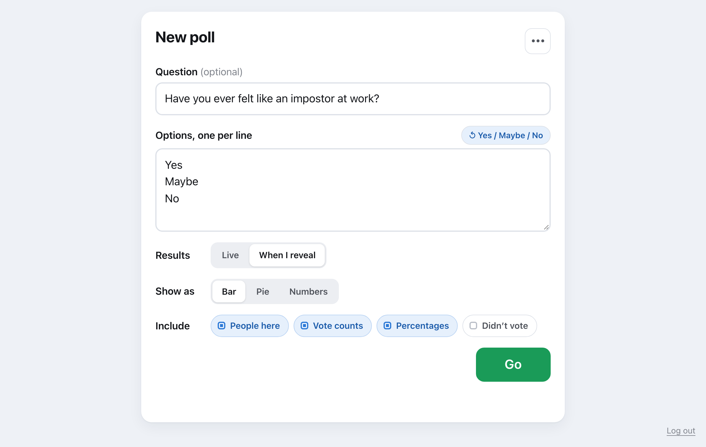
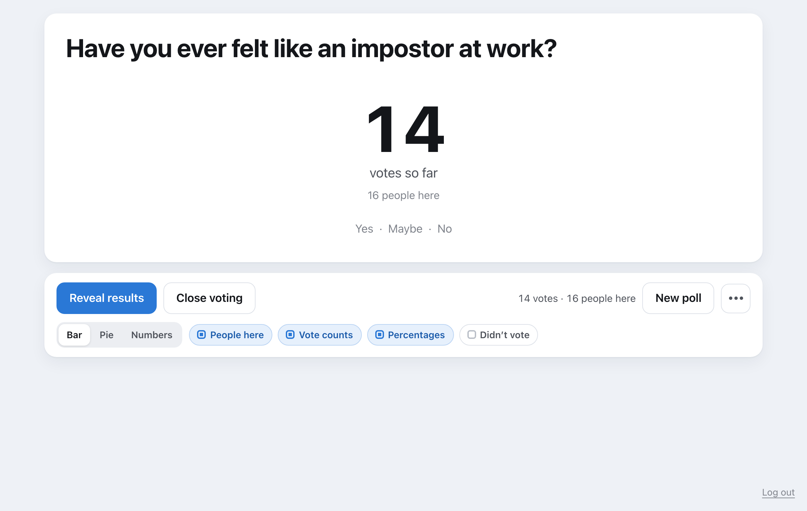
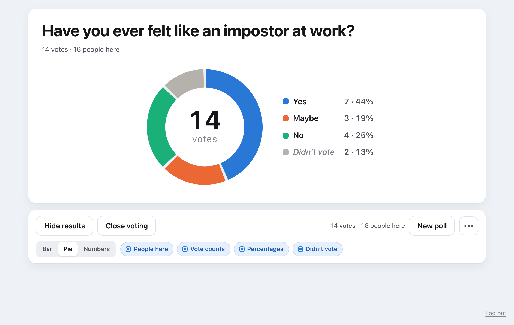
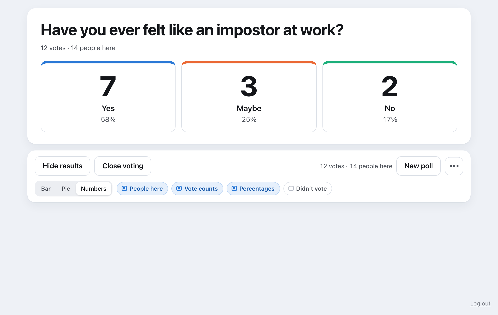

# Live Meeting Anonymous Poll

A simple web page for asking a group a question during a video call and getting **honest, anonymous answers**, live.

Some questions are hard to answer out loud in front of colleagues: *"Have you ever felt like an impostor at work?"*,
*"Is your workload manageable?"*, *"Did that change make your job harder?"*. When nobody can see who picked what,
people answer honestly, and everyone gets to see how common a feeling really is.

## How it works on a call

1. **Send everyone the link** in the meeting chat, and tell them the password.
2. **Everyone opens it** on their phone or computer and types the password. They see *"Waiting for the next question…"*.
3. **You (the host) log in** on the same page with the host password, and **share your screen**.
4. **Ask your question** out loud. The answers are *Yes / Maybe / No* unless you type your own, one per line.
5. **Press Go.** The buttons appear on everyone's screen straight away. Nobody needs to refresh.
6. **People tap an answer.** They can change their mind until you close voting.
7. **Reveal the results** when you're ready, or let everyone watch them come in live.

  
  &nbsp;
  

## What the host can do

Everything the host needs fits on one screen, because that's the screen everyone is watching.

- **New poll:** an optional question, the answers (one per line), and a **↺ Yes / Maybe / No** button to reset to the usual three.
- **Live or reveal later:** show results as votes arrive, or keep them hidden until you click **Reveal results**.
  While they're hidden, everyone only sees how many people have voted.
- **Show as:** a bar chart, a pie chart or just big numbers. You can switch at any time.
- **Include:** how many people are here, the number of votes, percentages, and a "Didn't vote" slice.
- **Close voting** to freeze the answers, and **Reopen** if you need to.
- **The ⋯ menu:** change the passwords, or log every participant out so they have to type the password again.

| Hidden until you reveal | Pie chart | Big numbers |
|---|---|---|
|  |  |  |

## Is it really anonymous?

Yes. Nobody gives a name or an email address, and the page never asks who you are. Each browser gets a random
code just so it can't vote twice, and that code isn't linked to any person. The host only ever sees totals, the same
as everyone else. While results are hidden, the totals aren't even sent to anyone's screen.

## Putting it on your own website

You need ordinary web hosting that runs **PHP** (version 5.6 or newer). There's no database and nothing to install.

1. Copy everything inside the `public` folder to a folder on your website, for example `yoursite.com/poll/`.
2. In that folder, make a copy of `config.example.php` called `config.php`, open it and choose your two passwords:
   one for the people voting and one for you, the host.
3. Make sure the web server can write to the `data` folder (that's where the current poll is kept).
4. Open the address in your browser. That's it.

The passwords aren't case sensitive. Once it's running you can change them from the ⋯ menu instead of editing the file.

### For developers

- `public/index.html`, `app.js` and `app.css` are the whole page: plain HTML, CSS and JavaScript, no frameworks.
  Pages check for updates about once a second.
- `public/api.php` is the server side. The current poll is saved in `public/data/`, which the included `.htaccess`
  blocks from the web (on Apache; on other servers, block that folder yourself).
- `scripts/deploy.sh` copies the site to a server over SSH. Copy `scripts/deploy.env.example` to `scripts/deploy.env`
  and fill in your server details first.

## Licence

Copyright © 2026 Simon Paul Jones.

This is free software under the [GNU Affero General Public License v3.0](LICENSE) (AGPL-3.0). In plain terms:

- You can use it, change it and share it, free of charge.
- If you share it, or a changed version of it, you must share the source code too, under the same licence.
- If you run a changed version as a website for other people, you must offer them its source code as well.

So it stays free for everyone, and nobody can take it and lock it away.
